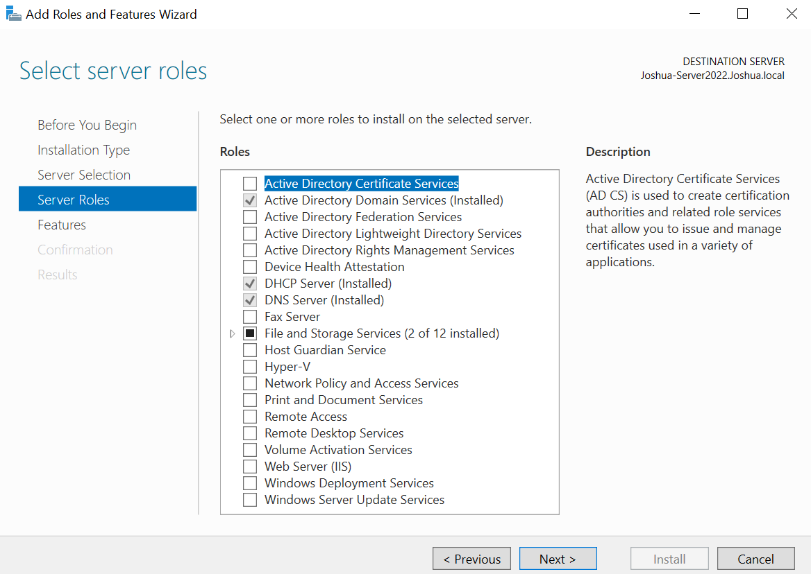
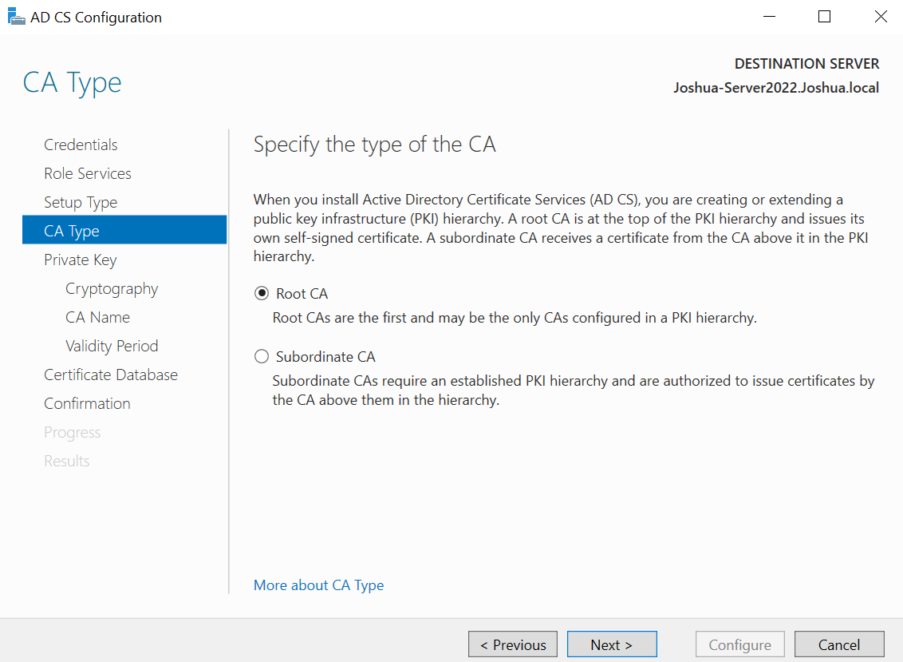
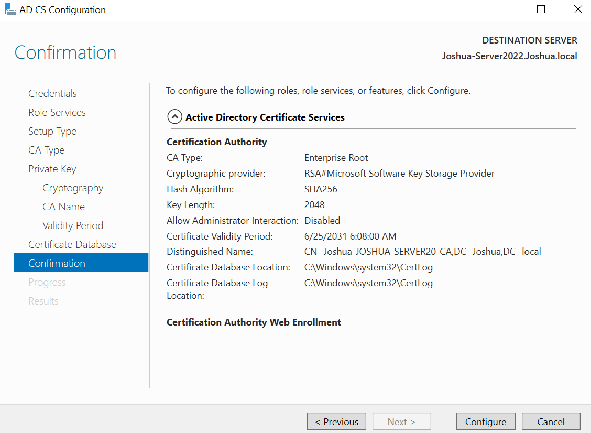
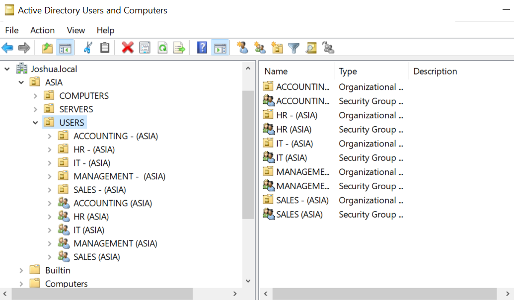
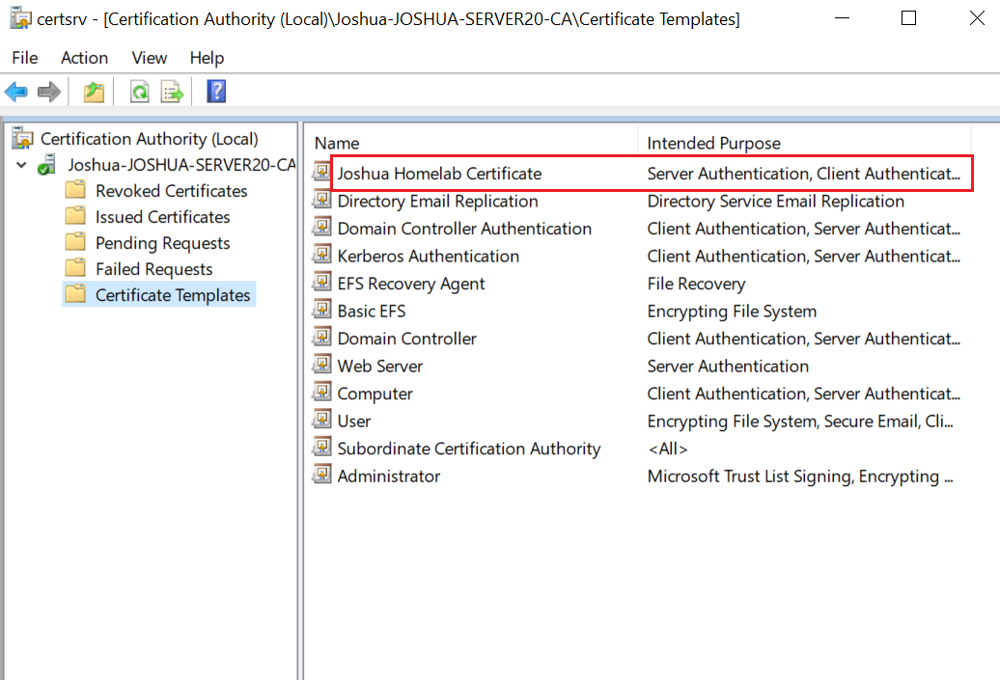
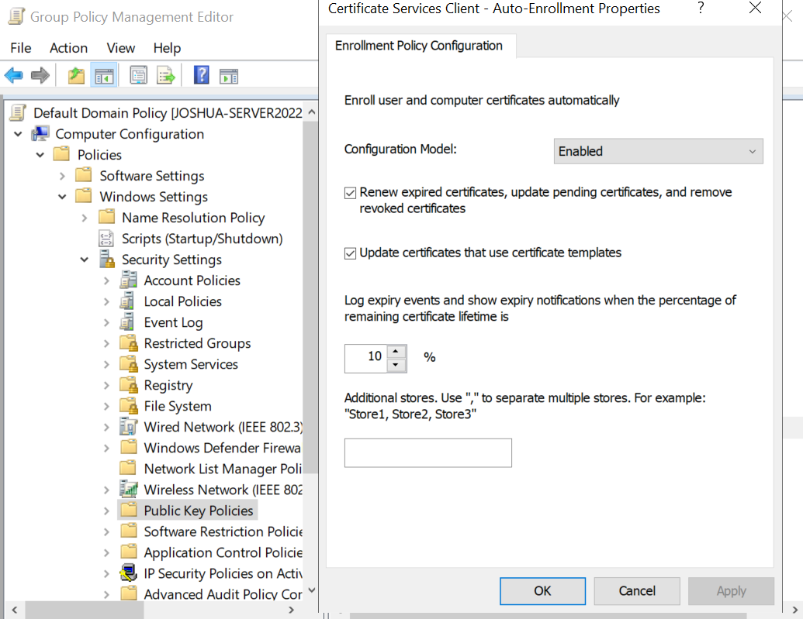
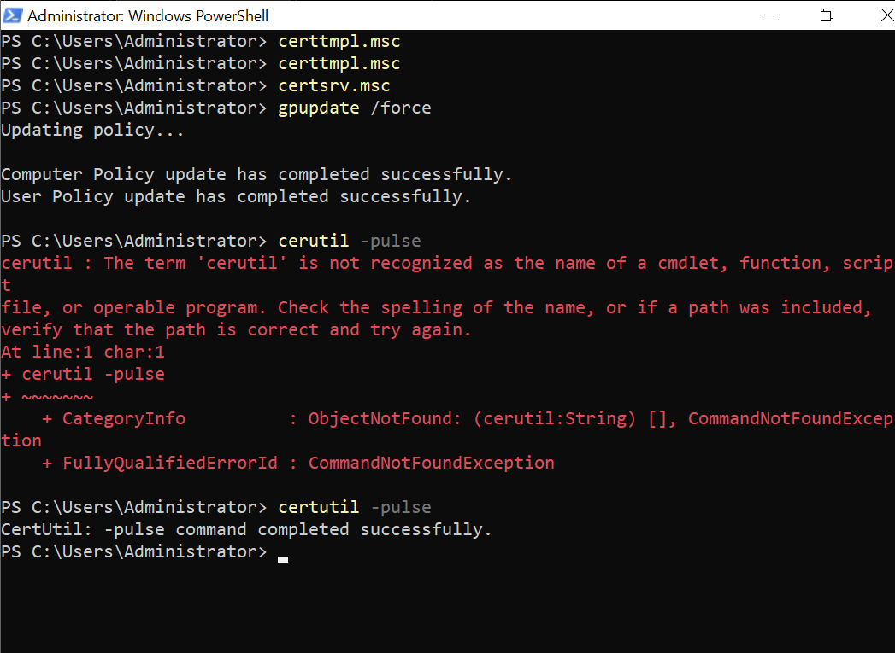
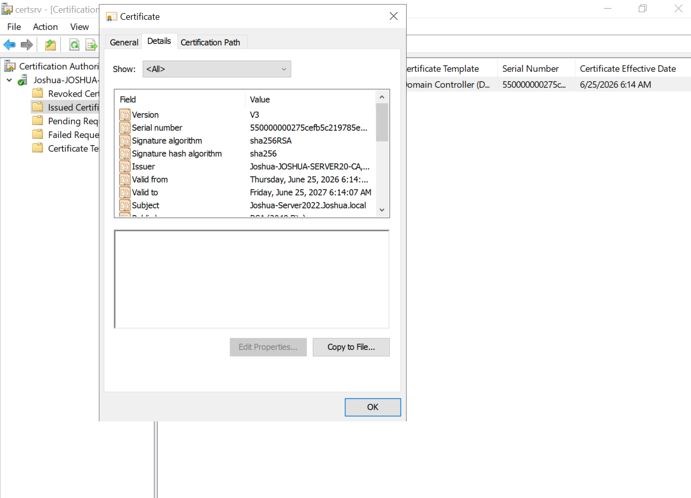

# Active Directory Certificate Services (AD CS)

Part of the [Active Directory Homelab](../) series.

In this module I stood up an internal PKI with Active Directory Certificate Services: an Enterprise Root CA, a certificate template, and autoenrollment, ending with a Windows 10 client holding a certificate issued by my own CA. Getting there meant working through three real enrollment problems (template permissions, Group Policy autoenrollment, and trust propagation), which was the useful part.

## The environment

| Component | Configuration |
|---|---|
| Certificate Authority | `JOSHUA-SERVER2022-CA` |
| CA server | `JOSHUA-SERVER2022` |
| CA type | Enterprise Root CA |
| Client | Windows 10 |
| Key length | 2048-bit RSA |
| Hash | SHA-256 |
| Key storage | Microsoft Software Key Storage Provider |
| Management tool | `certlm.msc` |

I wanted to understand how organizations use an internal CA to establish trust, because from a SOC seat PKI shows up constantly: enrollment failures, expired certificates, broken trust chains, TLS events, and misconfigured or over-permissioned certificate templates. This module pushes the lab beyond identity into certificate and trust infrastructure.

## How I built it

**Install AD CS.** I added the Active Directory Certificate Services role to `JOSHUA-SERVER2022` and configured it as an Enterprise Root CA.

**Configure the CA.** I set the CA name, validity period, a 2048-bit RSA key, SHA-256 hashing, and the Microsoft Software Key Storage Provider. The result was `JOSHUA-SERVER2022-CA`.

**Create a certificate template.** I made a template to control enrollment, with Read, Enroll, and (where applicable) Autoenroll permissions scoped to the intended entities.

**Enable autoenrollment via Group Policy.** Under Computer Configuration → Policies → Windows Settings → Security Settings → Public Key Policies → Certificate Services Client - Auto-Enrollment, then refreshed the client with `gpupdate /force`.

**Validate.** I inspected the issued certificate in `certlm.msc`, checking the chain, the issuing CA, the RSA key, and the key storage provider.

## What went wrong

**Template permissions.** The client couldn't enroll at first. The template's security permissions weren't set correctly, so I added the right group and granted Read, Enroll, and Autoenroll where applicable. Enrollment depends not just on a template existing but on its permissions being right.

**Autoenrollment still didn't fire.** Even with the template fixed, automatic enrollment didn't happen. It was Group Policy: autoenrollment has to be explicitly enabled under Public Key Policies → Certificate Services Client - Auto-Enrollment. After enabling it and running `gpupdate /force`, the client enrolled. Enrollment can depend on several layers, so when troubleshooting I learned to check both template permissions and GPO.

**Broken trust chain.** A certificate first showed a broken trust path, because the root CA certificate hadn't propagated to the client's Trusted Root Certification Authorities yet. Refreshing Group Policy and rechecking the trust path resolved it. Trust depends on the client being able to build a valid chain back to a CA it trusts.

## Evidence

**Selecting the AD CS role in the Add Roles and Features wizard**

**Choosing Root CA as the CA type**

**The confirmation page: Enterprise Root CA, RSA 2048-bit, SHA256, five-year validity**

**The OU structure the CA integrates with**

**The "Joshua Homelab Certificate" template published on the CA, for server and client authentication**

**The Group Policy setting that turns on certificate autoenrollment for domain members**

**Forcing a policy refresh with `gpupdate /force` and enrollment with `certutil -pulse`. The first attempt failed because I typed `cerutil`; the second worked.**

**A certificate issued by `Joshua-JOSHUA-SERVER20-CA`, shown in the Certification Authority console**

## What I'd do next

The current setup is a working PKI foundation. In a more production-oriented version I'd add templates for different use cases, test certificate renewal, expiration and revocation (CRLs and OCSP), test certificate-based authentication, and pull certificate-related Windows events into my monitoring. I'd also spend more time on certificate template security specifically, since over-permissioned enrollment rights are a real attack surface in AD. That would move the lab from deploying PKI to assessing and monitoring it.

## Related modules

| Module | Description |
|---|---|
| [01: Core Infrastructure](../01-Core-Infrastructure/) | AD, DNS, and DHCP |
| [02: Users & OUs](../02-Users-And-OUs/) | Users, groups, and OU structure |
| [04: Client Domain Join](../04-Client-Domain-Join/) | Joining Windows clients to the domain |
| [05: Group Policies](../05-Group-Policies/) | Centralized security and configuration |
| [06: File Server & Shares](../06-File-Server-Shares/) | Department shares and NTFS permissions |

---

[← Back to Active Directory Homelab](../)
