# Phase 0: Visibility Foundation

Before I attacked anything, I wanted to know whether my domain could answer one question: who logged into what, and when? This phase is the logging I set up on the domain controller and the Windows 10 client to answer it, shipped into the Elastic Stack I built in my [SIEM lab](../../02-SIEM-Lab-ELK-Stack).

If I'd skipped this and gone straight to attacks, I'd have had no way to tell whether any of them were detectable.

## What I set up

| Piece | Tool |
|---|---|
| Endpoint telemetry | Sysmon with the SwiftOnSecurity config |
| Script logging | PowerShell Script Block and Module Logging |
| Audit policy | Advanced Audit Policy through Group Policy |
| A tripwire | A SACL and a canary token on a file share |
| Shipping | Winlogbeat 8.12.0 |
| SIEM | Elasticsearch and Kibana 8.12.0 |
| Hosts | Domain controller `Joshua-Server2022`, Windows 10 client `MY-LAB-PC` |

```
┌────────────────────┐        ┌────────────────────┐
│  Domain Controller  │        │  Windows 10 Client   │
│  (Joshua-Server2022)│        │  (MY-LAB-PC)         │
│                      │        │                      │
│  • Sysmon            │        │  • Sysmon            │
│  • PowerShell logging│        │  • PowerShell logging│
│  • Advanced Audit    │        │  • Winlogbeat         │
│    Policy + SACL     │        │                      │
│  • Winlogbeat         │        │                      │
└──────────┬───────────┘        └──────────┬───────────┘
           │        HTTPS (Winlogbeat → Elasticsearch)  │
           └───────────────────┬───────────────────────┘
                                ▼
                     ┌─────────────────────┐
                     │   Elasticsearch      │
                     │   (self-signed TLS)  │
                     └──────────┬───────────┘
                                ▼
                     ┌─────────────────────┐
                     │       Kibana         │
                     │  winlogbeat-* view   │
                     └─────────────────────┘
```

## How I built it

### Sysmon

I installed Sysmon on both hosts with [SwiftOnSecurity's sysmon-config](https://github.com/SwiftOnSecurity/sysmon-config), which keeps the attacker-relevant events and filters out most of the routine Windows noise.

```powershell
.\Sysmon64.exe -accepteula -i sysmonconfig-export.xml
```

I checked it with `sc query sysmon64` and confirmed events were landing in `Applications and Services Logs > Microsoft > Windows > Sysmon > Operational`.

### PowerShell logging

In Group Policy, under **Computer Configuration > Administrative Templates > Windows Components > Windows PowerShell**, I turned on Module Logging (`*`) and Script Block Logging. Then I ran some PowerShell and confirmed Event IDs 4103 and 4104 in the PowerShell Operational log.

### Advanced Audit Policy

| Category | Subcategories | Event IDs |
|---|---|---|
| Logon/Logoff | Audit Logon, Audit Logoff | 4624, 4625, 4634 |
| Account Logon | Kerberos Authentication Service, Kerberos Service Ticket Operations | 4768, 4769, 4771, 4776 |
| Account Management | User Account Management, Security Group Management | 4720, 4722, 4724, 4738 |
| Object Access | File System, File Share | 4663 |

I also turned on "Audit: Force audit policy subcategory settings to override audit policy category settings". Without it, the legacy audit policy can quietly override everything above. That exact problem came back to bite me in Phase 1.

### A SACL and a canary token on a file share

I added a SACL to a file share that audits Create, Append and Delete. My first attempt was through the mapped drive, and Windows complained about a "remote setting" and stripped the inherited entries. Setting it on the server's local folder path worked.

I also dropped a canary token file into the same share. It alerts on its own if anyone opens it, so it still works even if my SIEM pipeline is down.

### Winlogbeat

Winlogbeat on both hosts ships the Application, System, Security, Sysmon and PowerShell Operational logs straight to Elasticsearch:

```yaml
winlogbeat.event_logs:
  - name: Security
  - name: Microsoft-Windows-Sysmon/Operational
  - name: Microsoft-Windows-PowerShell/Operational

output.elasticsearch:
  hosts: ["https://<elk-host-ip>:9200"]
  ssl.verification_mode: none
  username: "elastic"
  password: "<redacted>"
```

Elastic 8.x turns on TLS by default with a self-signed certificate. Skipping verification is fine for an isolated lab, but not something I'd do in production.

### Checking it worked

I created a `winlogbeat-*` data view in Kibana, watched events arrive from both hosts, and ran the search I'd set as the goal for this phase:

```
event.code:4624
```

It returned a normal user logon with the user, the host and the time. That was the finish line.

## What went wrong along the way

- **"Access is denied" in Event Viewer.** Every time, it was UAC: I wasn't running elevated. It was never a real permissions problem.
- **The mapped-drive SACL.** As above, auditing has to be set on the local path.
- **A YAML comment in the wrong place.** I'd left `output.elasticsearch:` commented out while its child settings were active. Winlogbeat failed with "did not find the expected key", which looked unrelated. A `#` only comments out a line when it's the first character; at the end of a line it does nothing.
- **TLS by default.** Elastic 8.x expects `https://`, so the output needs either a trusted certificate or an explicit verification bypass.

## What I'd still change

- Send Winlogbeat through Logstash instead of straight to Elasticsearch, so I can enrich fields and name the index `winlogbeat-lab-*` to match my `filebeat-lab-*` index.
- Replace the self-signed certificate with a proper internal CA.
- Find out why Sysmon Event IDs 3 (network connection) and 22 (DNS query) don't fire reliably on the Windows 10 client. I noticed it here, and it turned into a real blind spot for LLMNR poisoning in Phase 1.
- Add index lifecycle management so `winlogbeat-*` doesn't grow forever.
- Build a baseline dashboard (logon volume, top event codes) instead of relying on ad hoc searches.

## Evidence

**Sysmon running with the SwiftOnSecurity config**

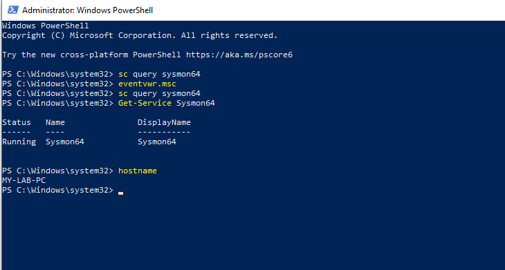

**PowerShell Module Logging (4103) and Script Block Logging (4104)**

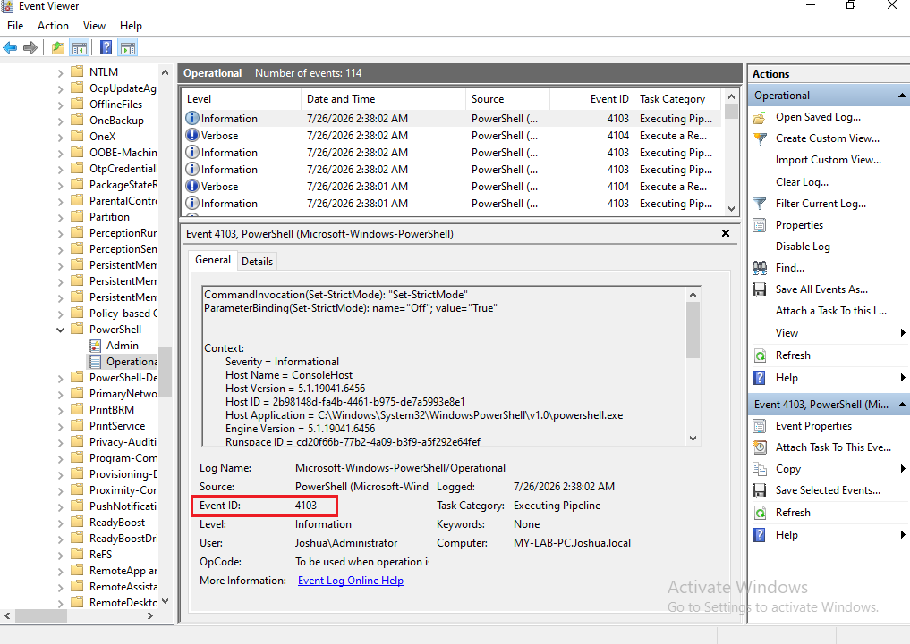
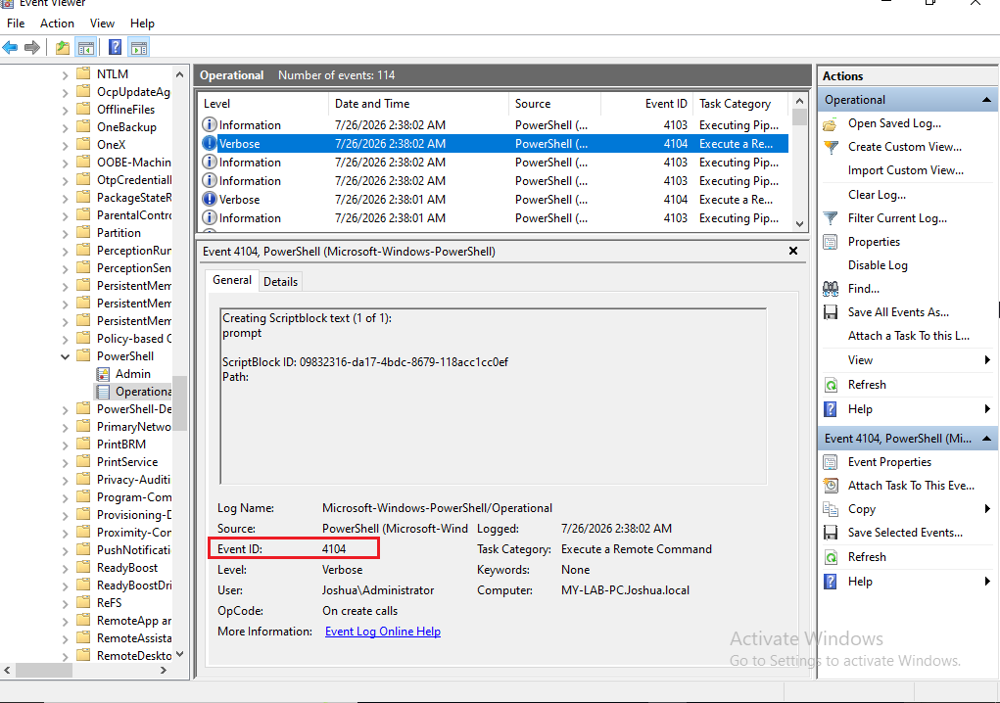

**Advanced Audit Policy in Group Policy**

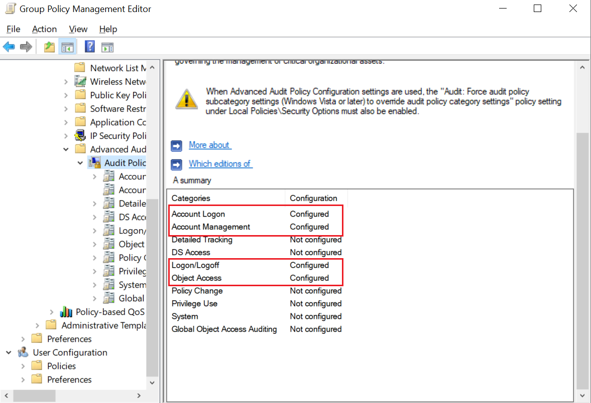
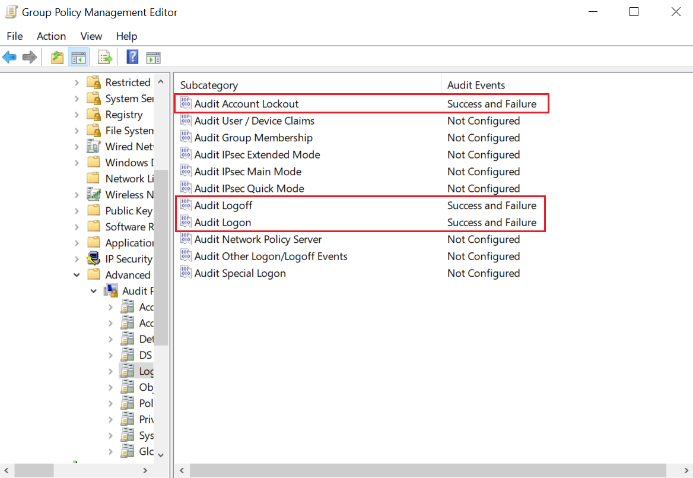
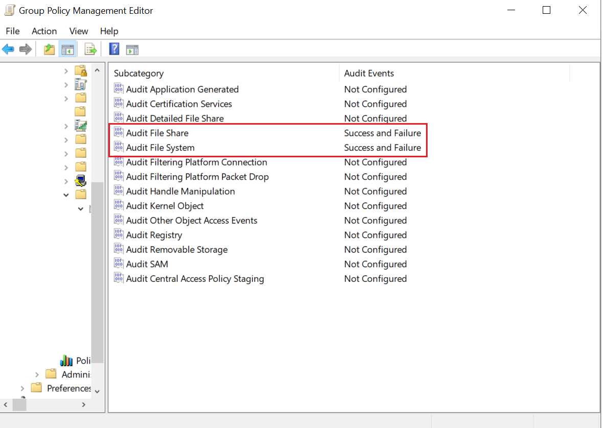

**Event ID 4663 after a create and delete on the audited share**

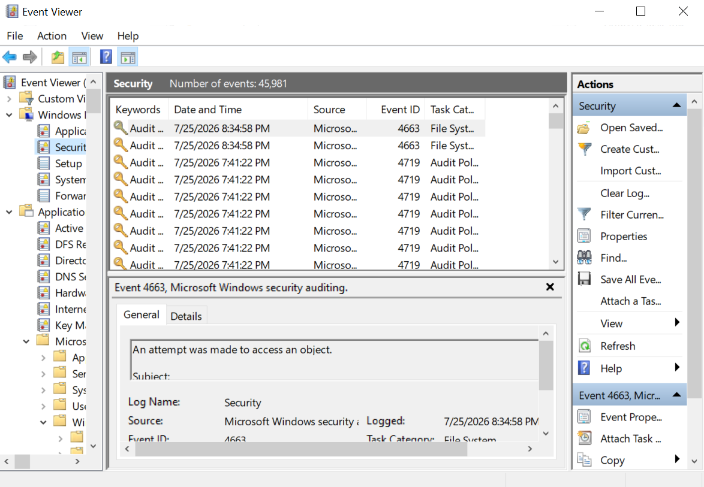

**Live winlogbeat-* data in Kibana**

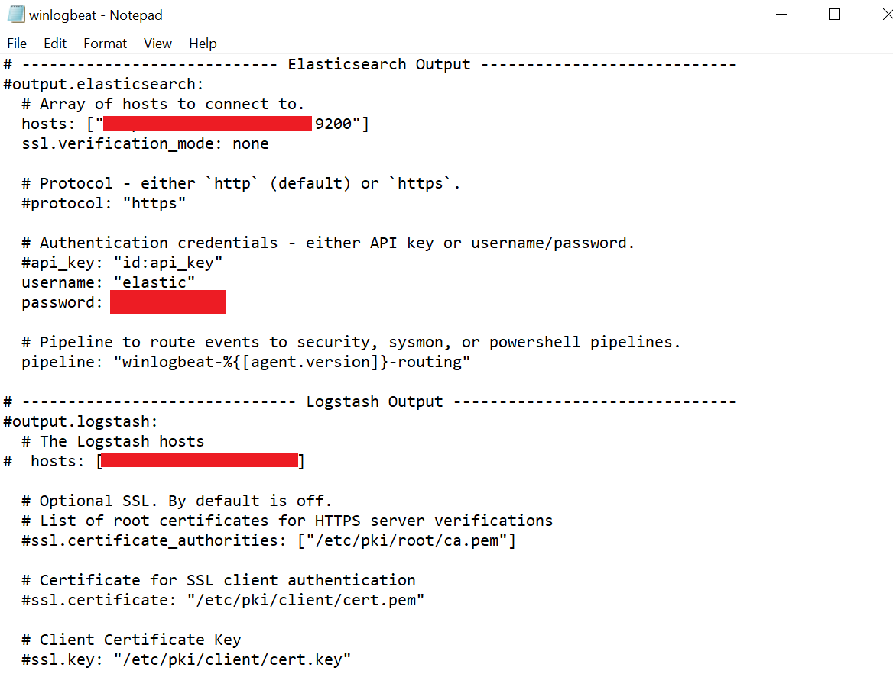
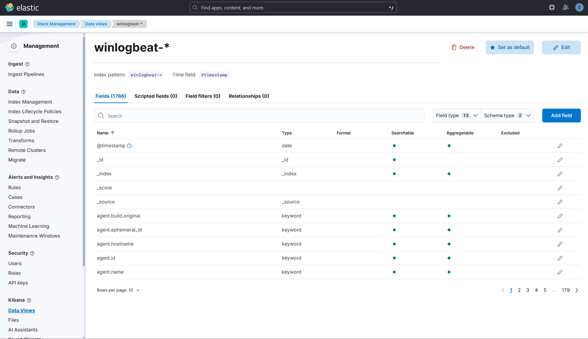
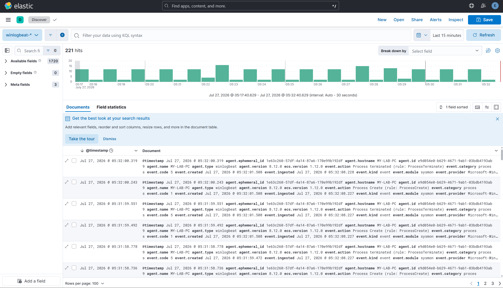

**Event ID 4624: a normal logon, searchable in Kibana**

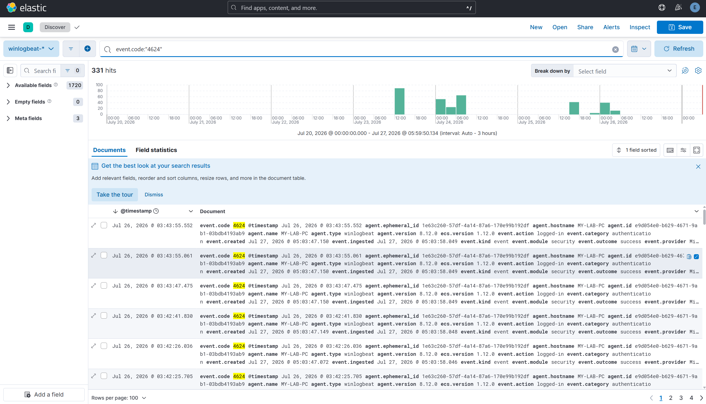

---

Next: [Phase 1: Credential Access](../Phase-1-Credential-Access) · Back to the [lab overview](../README.md)

*This is an isolated home lab. Hostnames, IP addresses and credentials shown are lab values or redacted.*
