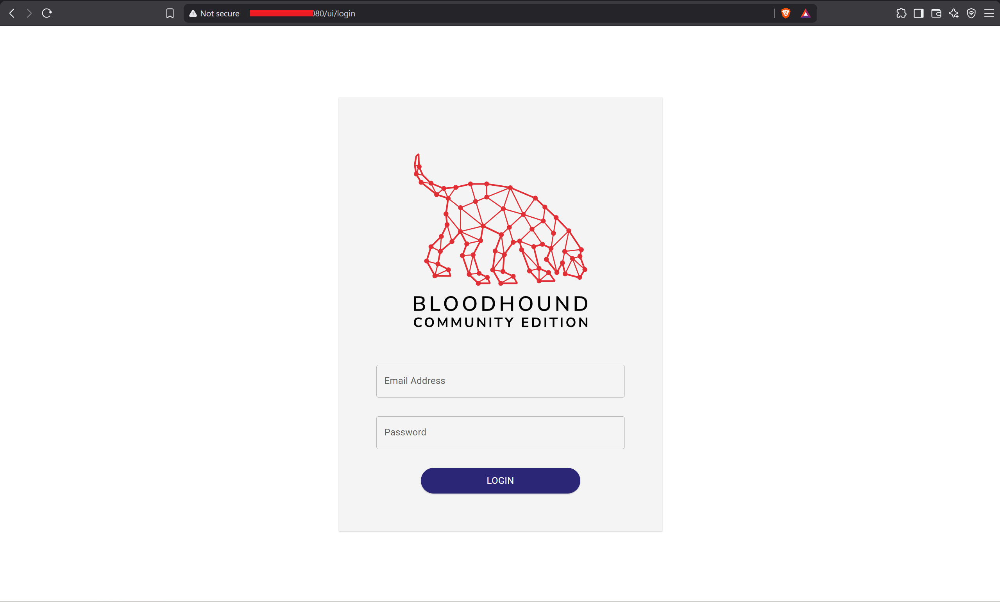
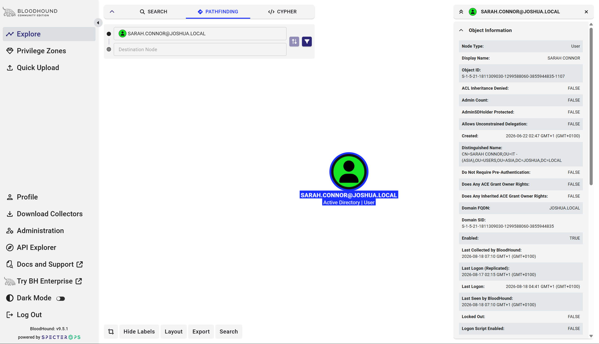
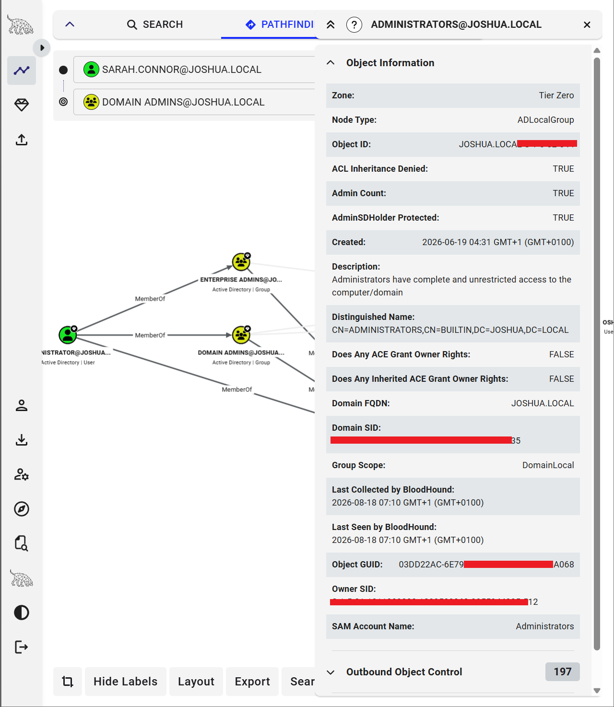

# Phase 2: Attack Path Mapping

After getting credentials in [Phase 1](../Phase-1-Credential-Access), the next question an attacker asks is: from here, where can I go? In this phase I answered that for my own domain with SharpHound and BloodHound, and found a confirmed path from an ordinary user account to Domain Admins. Phase 3 then walked that path.

## What I used

| | |
|---|---|
| Collection | SharpHound v2.14.0 |
| Analysis | BloodHound Community Edition (Neo4j and PostgreSQL) in Docker Compose |
| Hosts | Windows 10 domain client for collection, a separate Ubuntu server for analysis |
| Transfer | SSH and SCP |
| Queries | Cypher |

## How I did it

**Collection.** I ran SharpHound on the Windows 10 client, logged in as a normal low-privileged user. That's roughly what an attacker has after an initial foothold. I used a full collection (`-c All`): group memberships, ACLs, sessions, local admin rights, GPOs and trusts. It collected 464 objects.

**Analysis server.** I ran BloodHound CE in Docker Compose on its own Ubuntu VM, kept apart from the target domain, the way attacker infrastructure would be.

**Moving the data.** I set up SSH between the hosts and copied SharpHound's `.zip` of JSON from the Windows box to the Ubuntu server with SCP.

**Finding the path.** The BloodHound pathfinding screen kept showing unrelated relationships near the path, so I asked the question directly in Cypher, from one specific low-privileged user to Domain Admins:

```cypher
MATCH p=shortestPath((u:User {name:'<LOW_PRIV_USER>@DOMAIN.LOCAL'})-[*1..]->(g:Group {name:'DOMAIN ADMINS@DOMAIN.LOCAL'}))
RETURN p
```

It returned this path:

```
Low-Priv User --MemberOf--> Domain Users --MemberOf--> Local Users Group
    --LocalToComputer--> Target Server --HasSession--> Domain Admin Account
    --MemberOf--> Domain Admins
```

In plain terms: through nested group membership, an ordinary user could reach a server where a Domain Admin had a session. A Domain Admin session on a lower-tier machine means its credentials sit in that machine's memory, ready to be dumped.

## Problems I hit

- **Windows Defender and SmartScreen flagged SharpHound.** That's expected for an offensive tool, and a good sign the endpoint protection was doing its job.
- **A confusing .NET assembly-load error.** It turned out to be the "Mark of the Web" on the downloaded file, not anything wrong with the tool.
- **BloodHound was only reachable from the server itself.** Docker had bound the port to localhost. I changed the binding so I could reach it from my other VMs.

## What I learned

- What each BloodHound edge means to an attacker: `MemberOf`, `LocalToComputer`, `HasSession`, and ACL edges like `GenericAll` and `GenericWrite`.
- Cypher gives a definite answer where the visual pathfinder can suggest paths that aren't really there.
- I'd assumed servers were the bigger risk. Workstations often aren't: they're more exposed to phishing and usually less monitored. I had to correct that assumption during my own analysis.
- This is why AD tiering matters. Tier 0 accounts like Domain Admins shouldn't log into lower-tier machines at all.

## What I'd do next

- Script the whole pipeline: SharpHound run, transfer and BloodHound import.
- Run the pathfinding from several low-privileged users, not just one.
- Detect this reconnaissance in my Elastic pipeline. Right now SharpHound's collection isn't instrumented, so I can't see it happen.
- Fix the session exposure (stop the Domain Admin logging into non-Tier-0 machines) and re-run the analysis to confirm the path is gone.
- Capture the lab's VMs, network and Docker setup as code, so I can rebuild it quickly.

## Evidence

**SharpHound collection completed (464 objects)**


**BloodHound CE running in Docker Compose (Neo4j and PostgreSQL healthy)**


**BloodHound CE login, data import and dashboard**




**The confirmed attack path (Cypher `shortestPath` result)**




**Edge detail confirming source and target**




---

Previous: [Phase 1](../Phase-1-Credential-Access) · Next: [Phase 3: Lateral Movement](../Phase-3-Lateral-Movement) · Back to the [lab overview](../README.md)

*Everything here ran in an isolated lab I own. No production systems or real user data were involved.*
