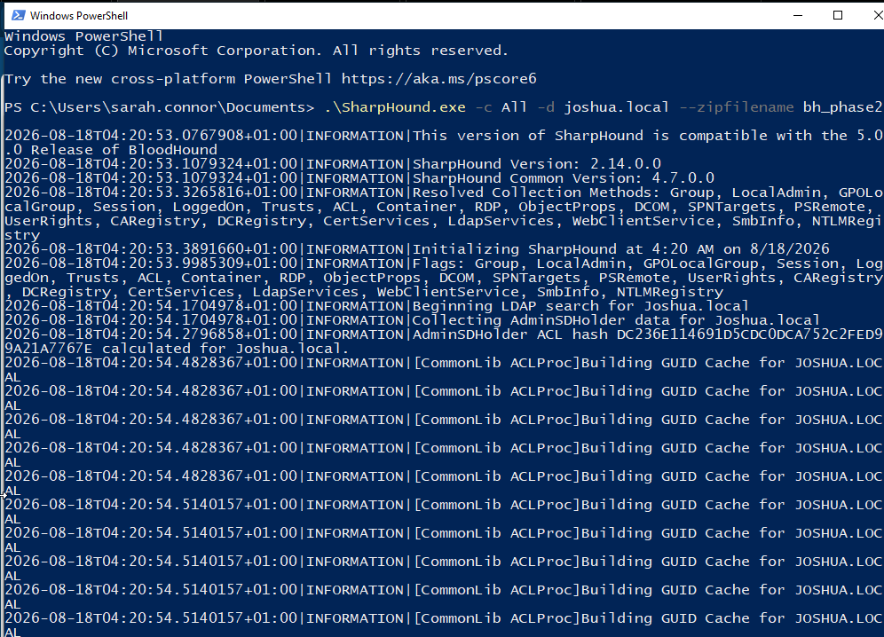
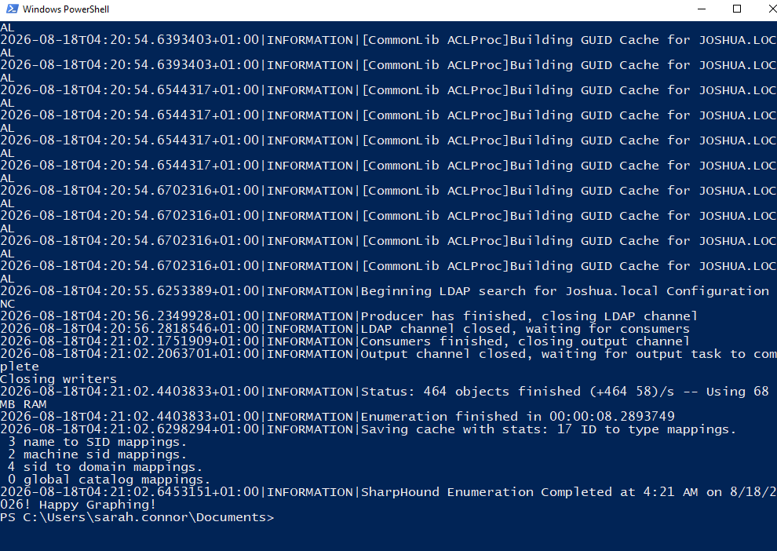
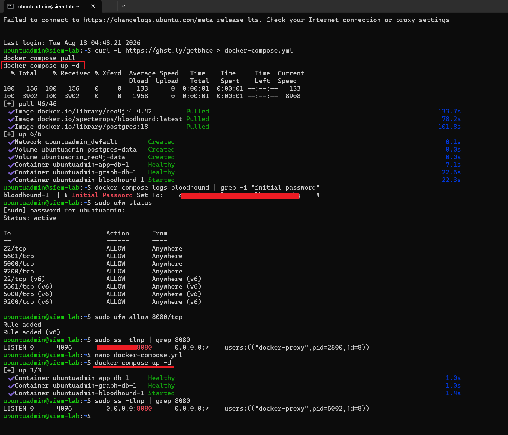
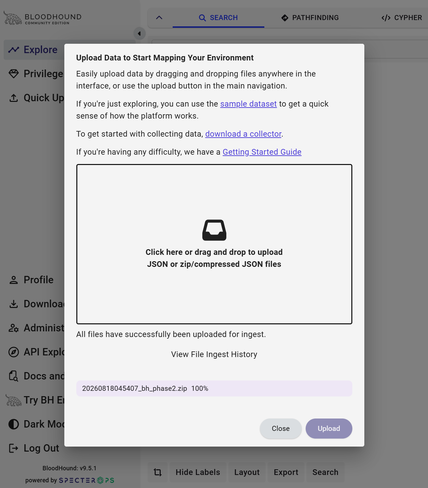
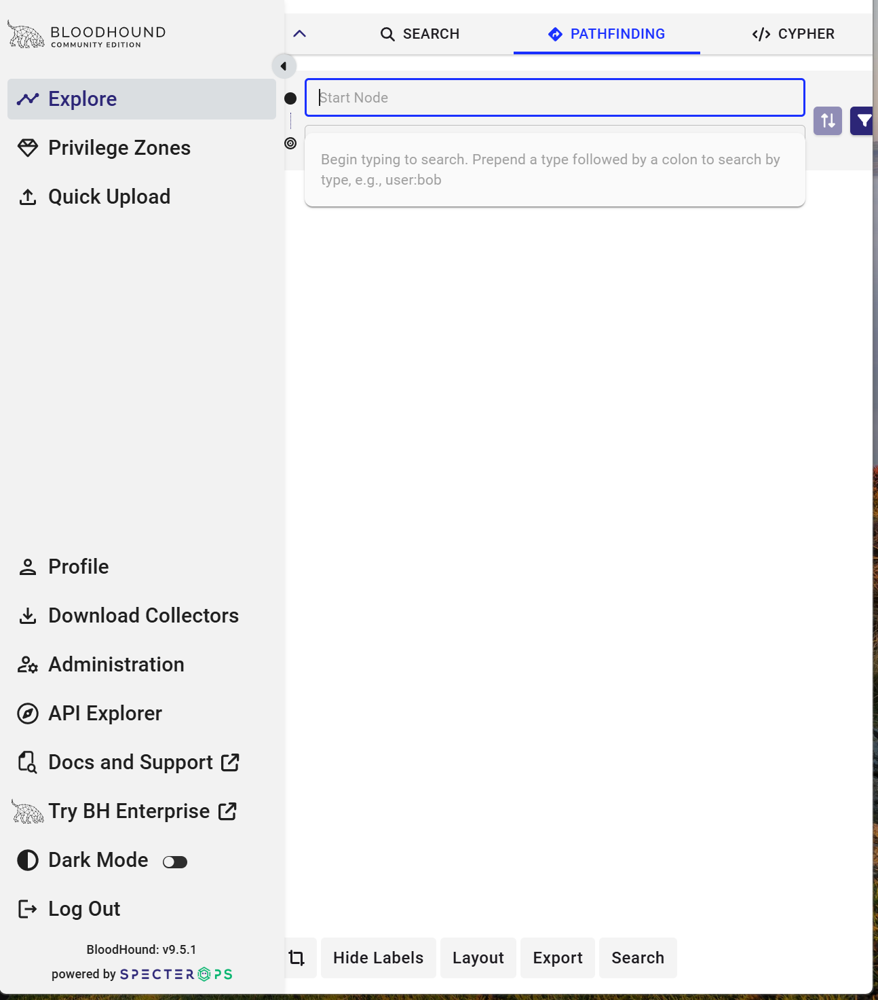
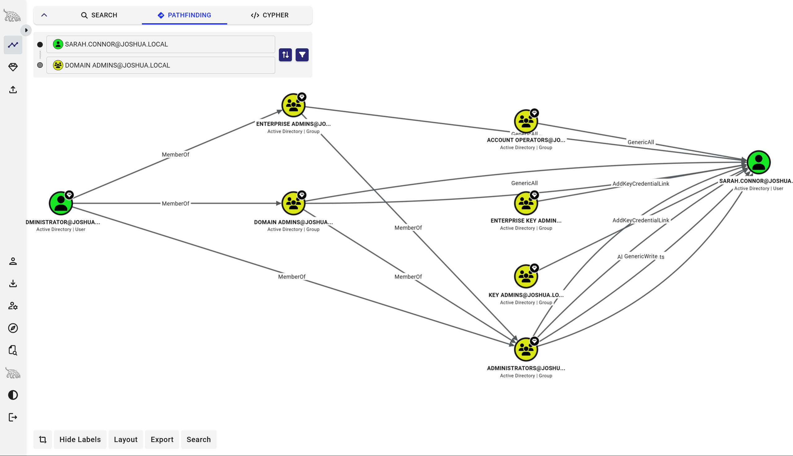
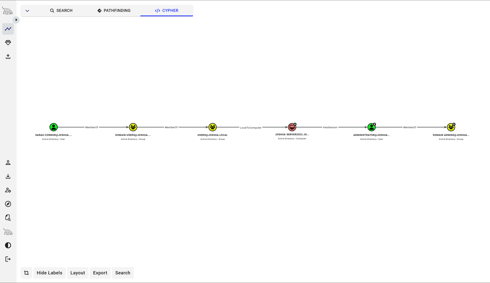
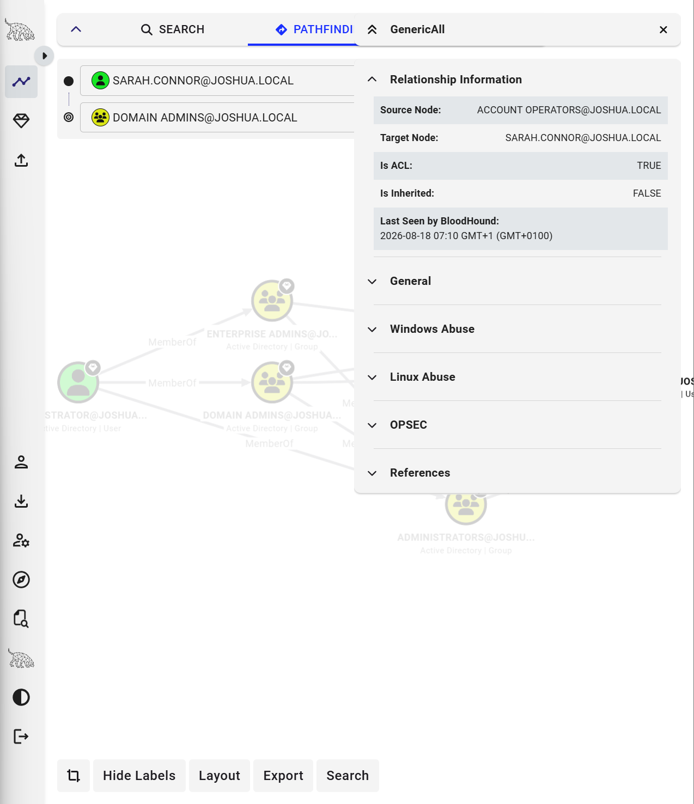

# Phase 2 - Active Directory Attack Path Mapping

**Home Lab Series:** Detection Engineering & Offensive Security in a Self-Hosted AD Environment
**Phase 2 of 6**: *Mapping the Terrain*
**Preceded by:** Phase 0 (Visibility Foundation), Phase 1 (Credential Access)
**Followed by:** Phase 3 (Lateral Movement), Phase 4 (Persistence), Phase 5 (Detection Engineering), Phase 6 (Incident Report)

> ⚠ **Educational Use Disclaimer:** This lab was built and executed entirely within an isolated, self-hosted virtual environment for personal learning and skills development. All tools, techniques, and targets belong to infrastructure I own and control. No production systems, third-party networks, or real user data were involved at any stage.

---

## Series Context

This repository documents a progressive, multi-phase home lab covering both **defensive** (detection engineering) and **offensive** (adversary emulation) security work inside a self-built Active Directory environment.

- **Phase 0** established the visibility foundation, a self-hosted Elastic Stack (Elasticsearch, Kibana, Logstash) ingesting Sysmon and Windows Event Log data via Winlogbeat.
- **Phase 1** exercised initial credential access techniques (LLMNR poisoning, password spraying, Kerberoasting, AS-REP roasting) against the domain.
- **Phase 2** (this phase) shifts to reconnaissance: mapping the domain's actual privilege relationships to identify real, exploitable paths to Domain Admin, the step a real attacker takes immediately after establishing a foothold.
- **Phase 3** built on this map to execute lateral movement and privilege escalation via a discovered GPO misconfiguration.
- **Phase 4** used the resulting access to perform DCSync and forge a Golden Ticket, achieving full domain persistence.

---

## 1. WHAT DID I BUILD?

An offensive reconnaissance pipeline against a live, self-hosted Active Directory domain, capable of automatically discovering privilege escalation paths from a standard user account to Domain Admin, using the same methodology employed by professional red teams and penetration testers.

Specifically, I:
- Ran the **SharpHound** collector (v2.14.0) against the lab domain from a low-privileged, domain-joined Windows 10 client
- Self-hosted **BloodHound Community Edition** via Docker Compose (Neo4j + PostgreSQL backend) on a dedicated Ubuntu server
- Built a secure, cross-host data pipeline (SSH/SCP) to move collection artifacts through an isolated, multi-VM lab network
- Used Cypher graph queries to **confirm**, not just visually infer, a directional attack path from a specific low-privileged user to the Domain Admins group

---

## 2. WHY DID I BUILD IT?

Active Directory is the identity backbone of most enterprise networks, and remains the single most common target in real-world breaches. Attackers rarely need a zero-day exploit, they need one nested group, one over-permissioned ACL, or one privileged account that logged into the wrong machine.

Having established a credential-access foothold in Phase 1, Phase 2 answers the next question a real attacker (and a real defender) must ask: *"Now that I'm in, where can I actually go from here?"* This phase builds the map that later phases (lateral movement, persistence) act on directly.

---

## 3. WHAT TECHNOLOGIES?

| Category | Tools / Tech |
|---|---|
| Data Collection | SharpHound v2.14.0 |
| Analysis Platform | BloodHound Community Edition |
| Containerization | Docker, Docker Compose |
| Graph Database | Neo4j |
| Backend Storage | PostgreSQL |
| Operating Systems | Windows 10 (domain client), Ubuntu Server |
| Virtualization | VMware Workstation |
| Networking / Transfer | SSH, SCP, SMB |
| Query Language | Cypher |
| Directory Services | Active Directory (self-hosted lab domain) |

---

## 4. HOW DID I BUILD IT?

**1. Data Collection**
Deployed SharpHound on a domain-joined Windows 10 client, authenticated as a standard low-privileged user, deliberately matching the access level of a real attacker's initial foothold. Ran a full collection (`-c All`) covering group memberships, ACLs, sessions, local admin rights, GPOs, and trust relationships.

**2. Analysis Environment**
Deployed BloodHound CE via Docker Compose on a separate Ubuntu server, physically isolating the analysis platform from the target domain, reflecting how attacker infrastructure is kept separate from a target environment in real engagements.

**3. Secure Data Transfer**
Configured SSH between hosts and used SCP to move the SharpHound output (a `.zip` of JSON graph data) from the Windows collection host to the Linux analysis server across an isolated lab network segment.

**4. Graph Analysis**
Ingested the collection data into BloodHound and ran a directional `shortestPath` Cypher query between a specific low-privileged user and the Domain Admins group, producing a mathematically confirmed path rather than relying solely on the visual pathfinding UI:

```cypher
MATCH p=shortestPath((u:User {name:'<LOW_PRIV_USER>@DOMAIN.LOCAL'})-[*1..]->(g:Group {name:'DOMAIN ADMINS@DOMAIN.LOCAL'}))
RETURN p
```

**The confirmed path:**
```
Low-Priv User --MemberOf--> Domain Users --MemberOf--> Local Users Group
    --LocalToComputer--> Target Server --HasSession--> Domain Admin Account
    --MemberOf--> Domain Admins
```

---

## 5. WHAT SECURITY CONCEPTS?

- **Attack Path Mapping**: modeling AD as a graph of identities, permissions, and sessions rather than a flat account list
- **Privilege Escalation via Nested Groups**: how group-within-group membership silently grants unintended access
- **Credential Exposure via Cached Sessions**: how a privileged account authenticating to a lower-tier machine exposes credentials to memory-dumping techniques (e.g., LSASS extraction)
- **Active Directory Tiering Model**: the principle that privileged (Tier 0) accounts should never authenticate to lower-tier assets
- **Least Privilege & Blast Radius**: how a single compromised low-privileged account can cascade into full domain compromise
- **Identity-Centric Defense**: recognizing that AD security requires continuous relationship auditing, not just patching and perimeter controls

---

## 6. WHAT DID I LEARN?

- How to operate SharpHound and interpret its collection methodology end-to-end
- How to deploy and troubleshoot a containerized security platform across a segmented, multi-VM lab network, including diagnosing a Docker port-binding issue that defaulted BloodHound to localhost-only access
- How to write and run Cypher queries to answer specific security questions directly, rather than relying solely on GUI-based pathfinding, which can visually surface unrelated nearby relationships
- What each core BloodHound edge type represents from an attacker's perspective (`MemberOf`, `LocalToComputer`, `HasSession`, and ACL-based edges like `GenericAll`/`GenericWrite`)
- That **workstation compromise is frequently more dangerous than server compromise**, due to greater exposure to phishing and typically lower monitoring, a misconception I had to correct during my own analysis
- Practical operational troubleshooting under real-world friction: expected AV/EDR flagging of offensive tooling (Windows Defender/SmartScreen correctly identifying SharpHound), the Windows "Mark of the Web" causing a confusing .NET assembly-load error, and cross-host authentication inside an isolated lab network

---

## 7. WHAT WOULD I IMPROVE?

- **Automate the pipeline**: script the SharpHound run, transfer, and BloodHound ingestion end-to-end to reduce manual steps
- **Expand test coverage**: run pathfinding across multiple low-privileged users to build a fuller picture of overall domain risk, rather than relying on a single test account
- **Close the loop with detection**: feed SharpHound/BloodHound collection activity into the Phase 0 Elastic Stack pipeline to detect this exact reconnaissance technique in near-real-time
- **Remediate and re-verify**: fix the identified session-exposure issue (stop the Domain Admin account from authenticating to non-Tier-0 assets), then re-run the analysis to confirm the path is closed
- **Infrastructure as code**: capture the lab's VM, network, and Docker configuration in version-controlled scripts for faster, more reliable rebuilds

---

## 8. WHAT EVIDENCE DO I HAVE?

**SharpHound collection completed (464 objects)**




**BloodHound CE running in Docker Compose (Neo4j and PostgreSQL healthy)**



**BloodHound CE login, data import and dashboard**





**The confirmed attack path (Cypher `shortestPath` result)**





**Edge detail confirming source and target**




---

## Folder Structure

```
Phase-2-Attack-Path-Mapping/
├── README.md
└── Screenshots/
    ├── 01-sharphound-complete/
    ├── 02-docker-compose-up/
    ├── 03-bloodhound-dashboard/
    ├── 04-attack-path-graph/
    └── 05-edge-detail/
```

---

*Part of an ongoing, self-directed home lab series bridging offensive reconnaissance techniques with defensive detection engineering. See the [lab overview](../README.md) for all phases.*
